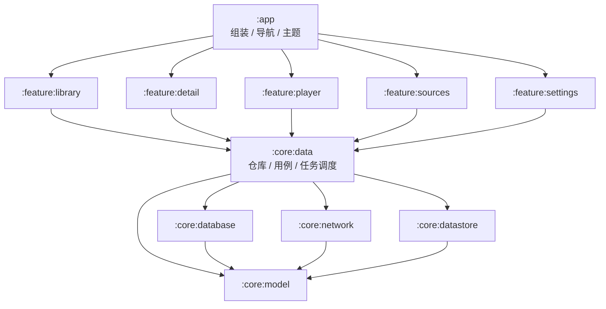

# MediaDock 架构与 10TB 改造计划

> 状态：草案（2026-10-18），供评审后按阶段实施。
> 目标：支撑 10TB+ 媒体库、多数据源、网易爆米花级功能；手机/平板优先，TV 与多端同步按决策单独排期。
> 本文只写架构与计划，不含运维信息（WebDAV 地址 / 账号 / 服务器一律不写进仓库）。

---

## 0. 结论摘要

- 现有架构（Kotlin + Compose + Media3 + Room + WebDAV）是合格的 MVP 底座，**不重写**。
- 但当前实现是“单数据源 + 全量列表 + 全量扫描 + 内存任务”的模型，直接叠 10TB 和爆米花级功能会先撞到四个地基：
  1. **数据身份**：用户数据按 `path` 存，改名/移动/多源会错位；
  2. **多数据源**：`StoredSource` 单例、单根目录；
  3. **增量扫描**：全量 BFS + 整表替换 + 2 万文件上限；
  4. **持久任务 + 分页**：扫描/刮削是内存 job，列表是全量 Flow + 内存过滤。
- 建议顺序：**先把这四块地基做完，再加高级功能**；否则每加一个功能都会返工。
- SQLite 不是瓶颈：5k–20k 条视频对 Room 很轻松；瓶颈是扫描请求数、TMDB 配额、海报渲染和状态管理。

---

## 1. 前提与待定决策

### 1.1 本文假设

- 单开发者 + AI 协作；个人自用，但代码质量和可交接性要求高。
- 手机/平板优先；TV、投屏、多端同步作为可选阶段。
- 10TB 主要在 WebDAV / OpenList（可能多个账号或多个 NAS），本地媒体为补充。
- 库规模按 **5,000–20,000 个视频文件、1,000–5,000 个作品**估算。
- 不引入自建后端，除非选择“多端同步”。

### 1.2 需要先定的产品决策

| 决策 | 选项 | 建议 | 影响 |
|---|---|---|---|
| TV / 投屏 | 仅手机平板 / 加投屏 / 加 TV | 先做投屏，TV 单独立项 | TV 会影响 UI 架构与焦点模型 |
| 多端同步 | 不做 / 自建轻量同步 / 云账号 | 先预留 `SyncProvider`，不做账号 | 决定是否需要后端 |
| 数据源种类 | WebDAV + 本地 / 加 SMB / 加 Emby/Jellyfin | 先 WebDAV + 本地，接口预留 | 多源是最大架构分叉 |
| DI | 手写容器 / Hilt | 现阶段保留手写容器 | 模块化后再评估 Hilt |

---

## 2. 现状盘点

### 2.1 应当保留的部分

- **分层边界**：`data/webdav`、`data/local`、`data/repo`、`player`、`ui/*` 职责清楚。
- **Room 是媒体库唯一数据源**：扫描只负责灌数据，海报墙只读 Room；这个原则必须保留。
- **播放架构**：`MediaSessionService` 持有 ExoPlayer，界面用 MediaController；后台播放、进度落库都在服务里。
- **凭据隔离**：`SecureCredentialStore` + Keystore AES-GCM；解密失败视为未配置。
- **硬约束**：401/429 不重试、真迁移、`MIGRATIONS` 数组、版本单一来源。
- **纯逻辑测试**：解析、分组、搜索、分享、更新、迁移链已有 98 条单测。

### 2.2 规模上来会先坏的地方

| 现状 | 10TB / 爆米花级下的问题 | 对策 |
|---|---|---|
| `StoredSource` 单例、单根 | 无法同时挂多个盘/账号 | `sources` 表 + `sourceId` |
| 扫描 `MAX_DIRECTORIES=4000` / `MAX_FILES=20000` | 大库直接撞上限 | 增量扫描 + 可配置上限 |
| 全量 BFS + `deleteAll` / 整批替换 | 每次扫全库，慢且浪费请求 | 目录级缓存 + 差异写入 |
| 内存 job + `StateFlow` | 进程一死扫描/刮削全丢 | WorkManager + 持久队列 |
| `observeAll()` + 内存 `groupWall` / 搜索过滤 | 2 万条会卡、内存高、搜索全表扫 | Paging 3 + SQL 过滤 + FTS |
| 进度/收藏/片单按 `path` 存 | 改名/移动/多源后用户数据错位 | 稳定 `logicalId` |
| 单 `LibraryRepository` 约 650 行 | 扫描/刮削/状态机/映射混在一起 | 拆 Scanner / Scraper / 查询仓库 |
| 详情页/首页按 `tmdbId` 内存合并 | 大库组合复杂、不可分页 | `works` 表 + 版本关系表 |
| 刮削无配额/续跑 | 2 万条 TMDB 会中断、重复请求 | 持久队列 + 令牌桶 + 预算 |

---

## 3. 目标架构

### 3.1 分层与模块



- **`:core:model`**：纯 Kotlin 数据模型、`SourceId` / `LogicalId`、纯函数（解析、分组规则）。
- **`:core:database`**：Room 实体 / DAO / 迁移 / FTS。只依赖 `:core:model`。
- **`:core:network`**：WebDAV、TMDB、字幕源等客户端；接口 + 实现。
- **`:core:datastore`**：凭据、设置、主题、同步游标。
- **`:core:data`**：仓库接口与实现、扫描/刮削调度、逻辑身份解析、播放地址解析。
- **`:feature:*`**：Compose 页面 + ViewModel + UiState；**禁止 feature 之间互相依赖**，跨页导航由 `:app` 负责。
- **`:app`**：`AppContainer`（或 Hilt 入口）、导航、底部栏、主题。

> 模块数量控制在 8–10 个。不要为了“架构好看”拆成十几个；模块化的目的是强制依赖方向和缩短构建，不是文件夹艺术。

### 3.2 技术框架

**保留**：Kotlin 2.x、Jetpack Compose（Material3）、Media3/ExoPlayer、Room、OkHttp、Coil3、kotlinx-serialization、DataStore、Navigation Compose、R8。

**新增（按阶段）**：

| 能力 | 选型 | 说明 |
|---|---|---|
| 长任务 | WorkManager | 扫描/刮削/同步；前台类型 `dataSync` |
| 分页 | Paging 3 + Room PagingSource | 海报墙按 `works` 分页 |
| 搜索 | Room FTS4（或 FTS5 trigram） | 中文分词需专门处理 |
| 播放软解 | Media3 FFmpeg decoder | RMVB/AVI/10-bit 兜底；注意包体与许可证 |
| 投屏 | Media3 Cast | 后置 |
| 依赖注入 | 暂时手写容器 | 模块化后按需评估 Hilt |
| 测试 | room-testing / work-testing / 假服务器 | 迁移、仓库、任务 |

**不引入**：NoSQL、跨端框架重写、微服务、为同步先建账号体系。

### 3.3 数据模型（核心）

#### 3.3.1 逻辑身份（最重要）

现有用户数据（进度/收藏/片单/改名）按 `path` 存；10TB 多源场景下必须改成**逻辑身份**：

- 已匹配：`tmdb:movie:<id>`、`tmdb:tv:<id>:s<S>:e<E>`；作品级用 `tmdb:tv:<id>` / `tmdb:movie:<id>`。
- 未匹配：`file:<sourceId>:<remoteKey>`（临时身份）。
- 一个逻辑条目可以对应**多个物理文件**（多版本、多数据源）；播放时选一个。
- 用户数据只引用 `logicalId`，播放位置按“集/电影”而不是文件。
- 文件移动/改名后，扫描重新关联到同一 `logicalId`；未匹配文件被刮削后，执行一次“临时身份 → 匹配身份”的迁移（合并进度/收藏/片单）。

#### 3.3.2 表结构（建议）

```text
sources(
  id TEXT PK, type TEXT, name TEXT, base_url TEXT, root_path TEXT,
  credential_ref TEXT, enabled INTEGER, priority INTEGER, created_at INTEGER,
  last_scan_at INTEGER, health TEXT
)

media_files(
  id TEXT PK,                 -- 物理文件 UUID
  source_id TEXT,             -- FK sources
  remote_key TEXT,            -- WebDAV 相对路径 / content URI
  logical_id TEXT,            -- 未匹配时为 file:<sourceId>:<remoteKey>
  name TEXT, size_bytes INTEGER, mtime TEXT, etag TEXT,
  scan_run_id INTEGER, missing_at INTEGER,
  UNIQUE(source_id, remote_key)
)

works(
  id TEXT PK,                 -- tmdb:movie:<id> / tmdb:tv:<id> / file:...
  tmdb_id INTEGER, type TEXT, title TEXT, year INTEGER,
  poster_path TEXT, backdrop_path TEXT, overview TEXT, rating REAL,
  total_seasons INTEGER, total_episodes INTEGER, updated_at INTEGER
)

episodes(
  id TEXT PK,                 -- tmdb:tv:<id>:s<S>:e<E>
  work_id TEXT, season INTEGER, episode INTEGER,
  title TEXT, still_path TEXT, runtime INTEGER, air_date TEXT
)

work_versions(work_id, file_id, source_id, quality_label, size_bytes, PRIMARY KEY(work_id, file_id))
work_genres(work_id, genre, PRIMARY KEY(work_id, genre))
people(id, name, profile_path)
work_cast(work_id, person_id, role, ordering, PRIMARY KEY(work_id, person_id))

progress(logical_id, user_id, position_ms, duration_ms, updated_at, device_id,
         PRIMARY KEY(logical_id, user_id))
favorites(logical_id, user_id, added_at, PRIMARY KEY(logical_id, user_id))
playlists(id, name, created_at)
playlist_items(playlist_id, logical_id, added_at, PRIMARY KEY(playlist_id, logical_id))
title_overrides(logical_id, title, year, PRIMARY KEY(logical_id))

scan_runs(id INTEGER PK AUTOINCREMENT, source_id, mode, status,
          started_at, finished_at, dirs, files, error)
directory_cache(source_id, remote_key, etag, last_modified,
                last_scan_run_id, child_count, PRIMARY KEY(source_id, remote_key))
scan_queue(source_id, remote_key, depth, PRIMARY KEY(source_id, remote_key))

scrape_tasks(logical_id TEXT PK, state TEXT, attempts INTEGER,
             next_attempt_at INTEGER, priority INTEGER, last_error TEXT, updated_at INTEGER)
```

说明：

- `media_files` 是物理事实，`works/episodes` 是展示与用户数据的逻辑层。
- `works` 是**分页单位**：海报墙/搜索/筛选都查 `works`，不再在内存里对全量 `media_items` 做 `groupWall`。
- `work_versions` 支持一部电影的多个文件/来源；详情页的版本切换从这张表来。
- 剧集进度按 `episodes.id` 记录；作品级“已看几集”由聚合查询得到。
- FTS：新增 `media_fts`（标题/别名/演员）；中文分词需要专门方案（见 3.6）。

### 3.4 扫描框架

**目标**：10TB 库首扫可完成，后续增量扫描只处理变化，断点可续，绝不因 401/429 连累其他设备。

- **执行载体**：`ScanWorker`（WorkManager，唯一工作名 `scan:<sourceId>`），长任务 `setForeground`；Android 14+ 声明 `FOREGROUND_SERVICE_DATA_SYNC` 与 `foregroundServiceType="dataSync"`。
- **模式**：`INCREMENTAL`（默认）/ `FULL`（用户手动）。
- **目录缓存**：`directory_cache` 存 `etag` / `last_modified` / `child_count`；根目录优先；如果集合的 etag/mtime 未变且子项数量一致，可跳过子树（OpenList 的集合元数据若不稳，提供“保守模式”：只跳过文件解析，不跳过 PROPFIND）。
- **差异写入**：
  - 新文件 → 插入 `media_files`；
  - 已有文件 → 比较 `size/mtime/etag`，变化则更新；
  - 目录中缺失 → 标 `missing_at`（软删除），不立即删用户数据；连续 N 次扫描仍缺失才清理物理记录。
- **持久队列**：`scan_queue` 存 BFS 待扫目录；进程被杀后按 `scan_runs` 续跑。
- **限速与安全**：每个 source 单飞（串行），可配置 1–2 并发；请求间最小间隔；401/429 **立即停止该 source 的所有请求**，写 `sources.health=BLOCKED`，由全局状态展示；绝不重试。
- **上限**：目录/文件上限改成可配置（默认 200k 目录 / 200k 文件），撞上限只标记“截断”，不冒充完整扫描。
- **批量写库**：每 N 条一批 `upsert`，不要在一次事务里跨网络请求。

### 3.5 刮削框架

**目标**：2 万条目可暂停、可续跑、按配额限速、失败不阻塞整轮。

- **持久队列**：`scrape_tasks`；扫描/详情页/手动重试都只入队。
- **Worker**：`ScrapeWorker` + 网络约束；批大小 4；令牌桶限速（按 TMDB 配额可配）；429 按 `Retry-After` 退避；401/凭据错误 → 整源暂停并引导设置；单条失败只影响自己。
- **优先级**：用户正在看的作品 > 最近添加 > 其余；失败条目按 `next_attempt_at` 指数退避。
- **预算**：DataStore 记录当日请求数；达到预算自动暂停，第二天/用户手动恢复。
- **匹配**：先精确（标题+年份+季集），失败再去年份；候选结果落库供手动匹配；匹配成功后写 `works/episodes` 并做“临时身份 → 匹配身份”的用户数据合并。

### 3.6 媒体库查询与 UI

- **分页**：海报墙/搜索/筛选统一查询 `works`（Paging 3），每页 30–60；筛选、排序在 SQL 完成（类型、年份、未看、最近添加、评分）。
- **搜索**：
  - 英文/数字：FTS4（`unicode61`）或 SQL `LIKE`；
  - 中文：SQLite 默认分词不适合中文。建议维护一列 `search_text`（标题 + 演员 + 类型，CJK 字符之间加空格，或存拼音首字母），用 FTS4 前缀匹配；或引入 FTS5 trigram。先做 20k 条基准测试再定。
  - 输入防抖 250ms；搜索走 Paging，不一次性加载全库。
- **UI 状态**：每个 feature 统一 `ViewModel + UiState`；composable 不得直接拿 `AppContainer`；筛选/排序状态用 `SavedStateHandle` 或持久化。
- **图片**：Coil 磁盘缓存设上限；列表只预取可见页；海报/剧照分尺寸请求；20k 条不做本地缩略图，除非有明确收益。
- **详情页**：作品详情、季/集、版本列表都来自 `works/episodes/work_versions`；按需加载，不在打开时拉全库。

### 3.7 播放框架

- **地址解析**：`PlaybackResolver` 按 `logicalId` 返回候选列表（来自 `work_versions`），按 source 优先级、可用性、清晰度排序；播放失败可切换候选；401/429 标记 source 不可用，**不重试**。
- **播放器**：保留 Media3 + `WebDavMediaDataSource`（改为按 source 取凭据）；保留媒体客户端 `Accept-Encoding: identity` / 无 `callTimeout`；保留 `WebDavLoadErrorPolicy`。
- **高级播放（按阶段）**：
  - FFmpeg 软解兜底（RMVB/AVI/10-bit）；
  - 画中画；
  - 投屏（Media3 Cast / DLNA）；
  - 字幕样式（字号/颜色/描边/背景/延迟）、音轨切换、倍速；
  - 跳过片头/片尾（存时间点）；
  - HDR/杜比：依赖设备与解码器，做兼容性检测，不承诺全设备。
- **进度**：按 `logicalId` 写；多源切换/换版本保持续播位置；可选同步到 `SyncProvider`。
- **服务**：`PlaybackService` 仍为唯一播放载体；通知、锁屏、后台行为保持现状。

### 3.8 多数据源

- **注册**：`sources` 表 + 添加/编辑/停用界面；每个 source 独立凭据（Keystore 加密）、根路径、优先级、限速。
- **类型**：先 WebDAV（OpenList）与本地；`MediaSource` 接口预留 SMB / Emby / Jellyfin。
- **合并**：同一作品/集按 `logicalId` 合并；`work_versions` 保留每个来源的文件；播放器按优先级选源，失败切换。
- **去重**：同一文件出现在多个 source（例如同一 OpenList 的多账号）：优先按 `tmdbId + season/episode + size` 识别；无法识别时保留为独立版本，不强行合并。
- **OpenList 多账号**：每个账号建一个 source，共享逻辑库；不要假设所有账号的根路径一致。

### 3.9 同步（可选）

- **接口**：`SyncProvider { suspend fun pull(since): SyncDelta; suspend fun push(delta) }`。
- **实现 A（推荐先做）**：WebDAV 上的 JSON 文件（用户自己的网盘），按设备分文件，最后写入者赢；适合个人多设备。
- **实现 B**：VPS 上的轻量 API + 用户令牌；需要服务端与冲突处理，后置。
- **同步内容**：进度、收藏、片单、改名；不同步凭据。
- **冲突**：按 `updatedAt` 最后写入者赢；片单/收藏可做并集；删除用 tombstone。

### 3.10 凭据与安全

- 每个 source 独立加密存储；解密失败 → 视为未配置，回到添加数据源（已实现）。
- `android:allowBackup` 排除凭据 DataStore；或接受恢复后强制重登。
- 明文流量：保留局域网 http 支持，但在添加数据源页对 `http://` 明确警告；后续可做按主机白名单。
- 分享功能：二次确认，默认不包含 TMDB 密钥。
- 日志：不写凭据/URL 中的密码/文件内容；手势类日志异步化。

### 3.11 可观测性与测试

- **日志**：结构化 tag（scan/scrape/player/sync）；落盘 + 可在设置里查看；20k 库的扫描/刮削进度可在“我的”页看到。
- **测试**：
  - 纯逻辑：解析、分组、筛选（现有）；
  - Room：`MigrationTestHelper` + 导出的 schema；v8→v9 起每一步都测；
  - 仓库：假 WebDAV（JDK HttpServer）+ 假 TMDB + 内存 Room；
  - WorkManager：`work-testing`；
  - 关键 UI：少量 Compose UI 测试（可选）；
  - 压力：生成 20k 条合成数据，测扫描写入、分页、搜索、内存。

---

## 4. 数据迁移策略

### 4.1 版本与前置

1. **先开启 `exportSchema = true`**，用当前 v8 代码生成 `app/schemas/8.json` 并提交（当前 `.gitignore` 忽略了 `app/schemas/`，要移除该规则）。
2. 从 v9 开始，每次结构变更都必须有：
   - `MediaDatabase.VERSION` +1；
   - `MIGRATIONS` 数组新增一条；
   - schema JSON 提交；
   - `MigrationTestHelper` 测试通过。
3. 升级方向绝不允许破坏性兜底；降级方向保持现状。

### 4.2 v8 → v9（地基迁移）

- 新增表：`sources`、`works`、`episodes`、`work_versions`、`work_genres`、`people`、`work_cast`、`scan_runs`、`directory_cache`、`scan_queue`、`scrape_tasks`。
- 现有表加列/改造：
  - `media_items`：加 `source_id`、`logical_id`（保留 `path` 作为 fallback）；
  - `playback_progress` / `favorites` / `playlist_items` / `title_overrides`：加 `logical_id`（保留原 path 列，双读/双写一个版本周期）。
- 回填：
  - 默认 source：现有 WebDAV 数据源；本地媒体单独 `LOCAL` source；
  - `logical_id`：有 `tmdbId` + 集数 → `tmdb:tv:<id>:s<S>:e<E>`；有 `tmdbId` + 无集数 → `tmdb:movie:<id>`；否则 `file:<sourceId>:<path>`；
  - 用户数据按 path 映射到 logical_id；同一逻辑条目多个文件时选最早/最完整的一个作为主记录。
- 回滚：v9 保留旧列；如果发现问题，v10 才移除旧列。迁移前让用户备份数据库（或 App 内导出）。

### 4.3 迁移验证

- 用真实 v8 库副本跑迁移，核对：视频数、进度条数、收藏数、片单数、改名数、详情数、总集数。
- 迁移后用 UI 抽查 10 个作品：进度、收藏、版本、季集。
- 只有迁移测试 + 真机抽查都通过，才允许进入下一阶段。

---

## 5. 分阶段路线图

### Phase 0 — 地基（建议先做）

**目标**：不改用户可见行为，先把数据模型和模块骨架搭好。

- 开启/提交 schema；模块骨架（`:core:model` / `:core:database` / `:core:network` / `:core:data`，feature 逐步迁）。
- v9 迁移：sources + logicalId + scan/scrape 表 + 回填。
- 拆 `LibraryRepository`：`MediaScanner`（WebDAV/本地）、`MetadataScraper`、`LibraryQueryRepository`。
- 统一 ViewModel / UiState；移除 composable 对 `AppContainer` 的直接依赖。
- 验收：现有 38 集、播放、收藏、片单全部正常；迁移测试通过；无数据丢失。

### Phase 1 — 10TB 扫描与刮削

- WorkManager 增量扫描 + `directory_cache` + 断点续扫 + 限速/封锁。
- 持久 `scrape_tasks` + Worker + 配额/退避。
- Paging 3 + SQL 筛选/排序 + FTS 搜索。
- 验收：20k 合成数据扫描不 OOM；中断后续跑；刮削可暂停/恢复；首页和搜索不卡。

### Phase 2 — 多数据源

- `sources` 管理界面；每源凭据/优先级/健康状态。
- `MediaSource` 实现：WebDAV、本地；预留 SMB / Emby / Jellyfin。
- 多源合并、版本切换、播放失败切换。
- 验收：两个 WebDAV 源 + 本地同时挂载；同一作品合并；源被封锁时其他源不受影响。

### Phase 3 — 高级播放

- FFmpeg 软解兜底；画中画；投屏；字幕样式；音轨；倍速；跳过片头尾；HDR/杜比兼容性检测。
- 验收：RMVB/AVI/10-bit 至少一种原本不能播的格式可播；投屏/画中画真机通过。

### Phase 4 — 同步 / TV（可选）

- `SyncProvider` + WebDAV JSON（或 VPS API）；多设备进度/收藏/片单。
- TV 端：单独 feature + 焦点/遥控器适配（若确认要做）。
- 验收：两台设备进度互相同步；冲突规则可解释。

---

## 6. 风险与对策

| 风险 | 影响 | 对策 |
|---|---|---|
| logicalId 迁移错误 | 用户进度/收藏错位或丢失 | 保留旧列、迁移测试、真机抽查、迁移前备份 |
| 扫描请求过多触发 OpenList 锁定 | 全站 WebDAV 不可用 | 单源串行、限速、401/429 全局封锁、绝不重试 |
| 20k 条 TMDB 刮削耗时/配额 | 刮削长期不完成 | 持久队列、预算、优先级、暂停/恢复 |
| 全量列表/内存分组 | 卡顿、OOM | Paging 3 + works 表 + SQL 过滤 |
| WorkManager 前台限制 | 长扫描被杀 | `dataSync` 前台类型 + 通知 + 可续跑 |
| 中文搜索分词 | 搜不到 | 专门的 search_text / trigram 方案，基准测试 |
| 多模块过度拆分 | 构建/维护成本 | 控制在 8–10 个模块 |
| FFmpeg 包体/许可证 | APK 变大、合规风险 | 后置，评估 LGPL/GPL 与体积 |
| TV/同步范围蔓延 | 架构分叉 | 先定决策，单独立项 |

---

## 7. 网易爆米花功能对照

| 功能 | 现状 | 目标阶段 |
|---|---|---|
| WebDAV / NAS 媒体库 | 有（单源） | Phase 2 多源 |
| 本地媒体 | 有（SAF / MediaStore） | 保留 |
| TMDB 刮削 | 有（同步、内存任务） | Phase 1 持久队列 |
| 分类 / 筛选 / 搜索 | 有（内存全量） | Phase 1 SQL + 分页 |
| 详情 / 演员 / 分集 | 有 | 保留 + works 表 |
| 收藏 / 历史 / 片单 | 有（按 path） | Phase 0 logicalId |
| 续播 / 播放进度 | 有（按 path） | Phase 0 logicalId |
| 字幕（内嵌/在线/本地） | 有 | 保留 + 样式 |
| 音轨 / 倍速 / 截图 | 有 | 保留 |
| 多版本切换 | 有（按 tmdbId） | Phase 2 多源版本 |
| 画中画 | 无 | Phase 3 |
| 投屏 | 无 | Phase 3 |
| HDR / 杜比 | 部分（设备相关） | Phase 3 检测 |
| 跳过片头/片尾 | 无 | Phase 3 |
| 多端同步 | 无 | Phase 4（可选） |
| TV 端 | 明确不做 | Phase 4（如改决策） |
| 分享给朋友 | 有（明文凭据） | 保留，加确认 |

---

## 8. 接口草图

```kotlin
// core:model
@JvmInline value class SourceId(val value: String)
@JvmInline value class LogicalId(val value: String)   // tmdb:... / file:...

enum class SourceType { WEBDAV, LOCAL, SMB, EMBY, JELLYFIN }
enum class ScanMode { INCREMENTAL, FULL }

data class Source(
    val id: SourceId,
    val type: SourceType,
    val name: String,
    val enabled: Boolean,
    val priority: Int,
)

// core:network
interface MediaSource {
    val id: SourceId
    suspend fun list(parentKey: String): List<RemoteEntry>
    suspend fun probe(): SourceHealth
}

// core:data
interface ScanScheduler {
    fun enqueue(sourceId: SourceId, mode: ScanMode)
    fun cancel(sourceId: SourceId)
}

interface ScrapeScheduler {
    fun enqueue(ids: List<LogicalId>)
    fun pause()
    fun resume()
}

interface PlaybackResolver {
    suspend fun candidates(id: LogicalId): List<PlaybackVariant>
}

interface SyncProvider {
    suspend fun pull(since: Long): SyncDelta
    suspend fun push(delta: SyncDelta)
}

// feature
data class LibraryFilter(
    val type: MediaType?,
    val genre: String?,
    val year: IntRange?,
    val unwatched: Boolean,
)
```

---

## 9. 第一个 PR 的范围

不做功能，只做地基，保证可回滚：

1. `ARCHITECTURE.md` 入库（本文件）。
2. 开启 `exportSchema`，生成并提交 `app/schemas/8.json`。
3. 新建 `:core:model` 模块，先放 `SourceId` / `LogicalId` / `SourceType` / 纯函数（不搬现有代码）。
4. v9 迁移骨架：新增 `sources` / `works` / `episodes` / `scan_runs` / `scrape_tasks` 等表；`media_items` 加 `source_id` / `logical_id`；回填脚本；保留旧列。
5. 加 `MigrationTestHelper` 测试（v8→v9）。
6. 用真实库副本跑一遍迁移，核对数据。
7. 全部通过后再进入 Phase 1。

> 约束不变：401/429 不重试、真迁移、版本单一来源、改完真机验证。
