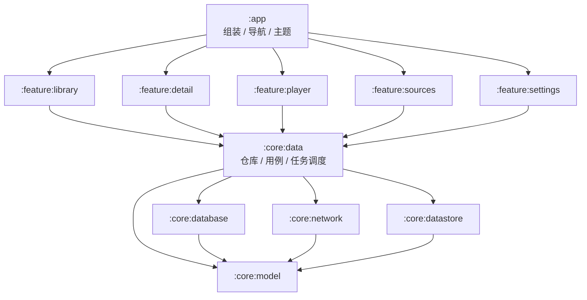

# MediaDock 架构与 10TB 改造计划

> 状态：草案（2026-10-18），供评审后按阶段实施。
> 目标：支撑 10TB+ 媒体库、多数据源、网易爆米花级功能；手机/平板优先，TV 与多端同步按决策单独排期。
> 本文只写架构与计划，不含运维信息（WebDAV 地址 / 账号 / 服务器一律不写进仓库）。

---

## 0. 结论摘要

- 现有架构（Kotlin + Compose + Media3 + Room + WebDAV）是合格的 MVP 底座，**不重写**。
- 但当前实现是“单数据源 + 全量列表 + 全量扫描 + 内存任务”的模型，直接叠 10TB 和爆米花级功能会先撞到四个地基：
  1. **数据身份**：用户数据按 `path` 存，改名/移动/多源会错位；
  2. **多数据源**：`StoredSource` 单例、单根目录；
  3. **增量扫描**：全量 BFS + 整表替换 + 2 万文件上限；
  4. **持久任务 + 分页**：扫描/刮削是内存 job，列表是全量 Flow + 内存过滤。
- 建议顺序：**先把这四块地基做完，再加高级功能**；否则每加一个功能都会返工。
- 高规格播放（HDR10 / HDR10+ / HLG / DV / 10-bit / Atmos / 高刷）按 **Phase 3 的 3A–3D** 推进：
  先能力探测与诊断，再直出，再降级/软解，最后投屏与体验项。
- SQLite 不是瓶颈：5k–20k 条视频对 Room 很轻松；瓶颈是扫描请求数、TMDB 配额、海报渲染和状态管理。

---

## 1. 前提与待定决策

### 1.1 本文假设

- 单开发者 + AI 协作；个人自用，但代码质量和可交接性要求高。
- 手机/平板优先；TV、投屏、多端同步作为可选阶段。
- 10TB 主要在 WebDAV / OpenList（可能多个账号或多个 NAS），本地媒体为补充。
- 库规模按 **5,000–20,000 个视频文件、1,000–5,000 个作品**估算。
- 不引入自建后端，除非选择“多端同步”。

### 1.2 需要先定的产品决策

| 决策 | 选项 | 建议 | 影响 |
|---|---|---|---|
| TV / 投屏 | 仅手机平板 / 加投屏 / 加 TV | 先做投屏，TV 单独立项 | TV 会影响 UI 架构与焦点模型 |
| 多端同步 | 不做 / 自建轻量同步 / 云账号 | 先预留 `SyncProvider`，不做账号 | 决定是否需要后端 |
| 数据源种类 | WebDAV + 本地 / 加 SMB / 加 Emby/Jellyfin | 先 WebDAV + 本地，接口预留 | 多源是最大架构分叉 |
| DI | 手写容器 / Hilt | 现阶段保留手写容器 | 模块化后再评估 Hilt |

---

## 2. 现状盘点

### 2.1 应当保留的部分

- **分层边界**：`data/webdav`、`data/local`、`data/repo`、`player`、`ui/*` 职责清楚。
- **Room 是媒体库唯一数据源**：扫描只负责灌数据，海报墙只读 Room；这个原则必须保留。
- **播放架构**：`MediaSessionService` 持有 ExoPlayer，界面用 MediaController；后台播放、进度落库都在服务里。
- **凭据隔离**：`SecureCredentialStore` + Keystore AES-GCM；解密失败视为未配置。
- **硬约束**：401/429 不重试、真迁移、`MIGRATIONS` 数组、版本单一来源。
- **纯逻辑测试**：解析、分组、搜索、分享、更新、迁移链已有 98 条单测。

### 2.2 规模上来会先坏的地方

| 现状 | 10TB / 爆米花级下的问题 | 对策 |
|---|---|---|
| `StoredSource` 单例、单根 | 无法同时挂多个盘/账号 | `sources` 表 + `sourceId` |
| 扫描 `MAX_DIRECTORIES=4000` / `MAX_FILES=20000` | 大库直接撞上限 | 增量扫描 + 可配置上限 |
| 全量 BFS + `deleteAll` / 整批替换 | 每次扫全库，慢且浪费请求 | 目录级缓存 + 差异写入 |
| 内存 job + `StateFlow` | 进程一死扫描/刮削全丢 | WorkManager + 持久队列 |
| `observeAll()` + 内存 `groupWall` / 搜索过滤 | 2 万条会卡、内存高、搜索全表扫 | Paging 3 + SQL 过滤 + FTS |
| 进度/收藏/片单按 `path` 存 | 改名/移动/多源后用户数据错位 | 稳定 `logicalId` |
| 单 `LibraryRepository` 约 650 行 | 扫描/刮削/状态机/映射混在一起 | 拆 Scanner / Scraper / 查询仓库 |
| 详情页/首页按 `tmdbId` 内存合并 | 大库组合复杂、不可分页 | `works` 表 + 版本关系表 |
| 刮削无配额/续跑 | 2 万条 TMDB 会中断、重复请求 | 持久队列 + 令牌桶 + 预算 |

---

## 3. 目标架构

### 3.1 分层与模块



- **`:core:model`**：纯 Kotlin 数据模型、`SourceId` / `LogicalId`、纯函数（解析、分组规则）。
- **`:core:database`**：Room 实体 / DAO / 迁移 / FTS。只依赖 `:core:model`。
- **`:core:network`**：WebDAV、TMDB、字幕源等客户端；接口 + 实现。
- **`:core:datastore`**：凭据、设置、主题、同步游标。
- **`:core:data`**：仓库接口与实现、扫描/刮削调度、逻辑身份解析、播放地址解析。
- **`:feature:*`**：Compose 页面 + ViewModel + UiState；**禁止 feature 之间互相依赖**，跨页导航由 `:app` 负责。
- **`:app`**：`AppContainer`（或 Hilt 入口）、导航、底部栏、主题。

> 模块数量控制在 8–10 个。不要为了“架构好看”拆成十几个；模块化的目的是强制依赖方向和缩短构建，不是文件夹艺术。

### 3.2 技术框架

**保留**：Kotlin 2.x、Jetpack Compose（Material3）、Media3/ExoPlayer、Room、OkHttp、Coil3、kotlinx-serialization、DataStore、Navigation Compose、R8。

**新增（按阶段）**：

| 能力 | 选型 | 说明 |
|---|---|---|
| 长任务 | WorkManager | 扫描/刮削/同步；前台类型 `dataSync` |
| 分页 | Paging 3 + Room PagingSource | 海报墙按 `works` 分页 |
| 搜索 | Room FTS4（或 FTS5 trigram） | 中文分词需专门处理 |
| 播放软解 | Media3 FFmpeg decoder | RMVB/AVI/10-bit 兜底；注意包体与许可证 |
| 投屏 | Media3 Cast | 后置 |
| 依赖注入 | 暂时手写容器 | 模块化后按需评估 Hilt |
| 测试 | room-testing / work-testing / 假服务器 | 迁移、仓库、任务 |

**不引入**：NoSQL、跨端框架重写、微服务、为同步先建账号体系。

### 3.3 数据模型（核心）

#### 3.3.1 逻辑身份（最重要）

现有用户数据（进度/收藏/片单/改名）按 `path` 存；10TB 多源场景下必须改成**逻辑身份**：

- 已匹配：`tmdb:movie:<id>`、`tmdb:tv:<id>:s<S>:e<E>`；作品级用 `tmdb:tv:<id>` / `tmdb:movie:<id>`。
- 未匹配：`file:<sourceId>:<remoteKey>`（临时身份）。
- 一个逻辑条目可以对应**多个物理文件**（多版本、多数据源）；播放时选一个。
- 用户数据只引用 `logicalId`，播放位置按“集/电影”而不是文件。
- 文件移动/改名后，扫描重新关联到同一 `logicalId`；未匹配文件被刮削后，执行一次“临时身份 → 匹配身份”的迁移（合并进度/收藏/片单）。

#### 3.3.2 表结构（建议）

```text
sources(
  id TEXT PK, type TEXT, name TEXT, base_url TEXT, root_path TEXT,
  credential_ref TEXT, enabled INTEGER, priority INTEGER, created_at INTEGER,
  last_scan_at INTEGER, health TEXT
)

media_files(
  id TEXT PK,                 -- 物理文件 UUID
  source_id TEXT,             -- FK sources
  remote_key TEXT,            -- WebDAV 相对路径 / content URI
  logical_id TEXT,            -- 未匹配时为 file:<sourceId>:<remoteKey>
  name TEXT, size_bytes INTEGER, mtime TEXT, etag TEXT,
  scan_run_id INTEGER, missing_at INTEGER,
  UNIQUE(source_id, remote_key)
)

works(
  id TEXT PK,                 -- tmdb:movie:<id> / tmdb:tv:<id> / file:...
  tmdb_id INTEGER, type TEXT, title TEXT, year INTEGER,
  poster_path TEXT, backdrop_path TEXT, overview TEXT, rating REAL,
  total_seasons INTEGER, total_episodes INTEGER, updated_at INTEGER
)

episodes(
  id TEXT PK,                 -- tmdb:tv:<id>:s<S>:e<E>
  work_id TEXT, season INTEGER, episode INTEGER,
  title TEXT, still_path TEXT, runtime INTEGER, air_date TEXT
)

work_versions(work_id, file_id, source_id, quality_label, size_bytes, PRIMARY KEY(work_id, file_id))
work_genres(work_id, genre, PRIMARY KEY(work_id, genre))
people(id, name, profile_path)
work_cast(work_id, person_id, role, ordering, PRIMARY KEY(work_id, person_id))

progress(logical_id, user_id, position_ms, duration_ms, updated_at, device_id,
         PRIMARY KEY(logical_id, user_id))
favorites(logical_id, user_id, added_at, PRIMARY KEY(logical_id, user_id))
playlists(id, name, created_at)
playlist_items(playlist_id, logical_id, added_at, PRIMARY KEY(playlist_id, logical_id))
title_overrides(logical_id, title, year, PRIMARY KEY(logical_id))

scan_runs(id INTEGER PK AUTOINCREMENT, source_id, mode, status,
          started_at, finished_at, dirs, files, error)
directory_cache(source_id, remote_key, etag, last_modified,
                last_scan_run_id, child_count, PRIMARY KEY(source_id, remote_key))
scan_queue(source_id, remote_key, depth, PRIMARY KEY(source_id, remote_key))

scrape_tasks(logical_id TEXT PK, state TEXT, attempts INTEGER,
             next_attempt_at INTEGER, priority INTEGER, last_error TEXT, updated_at INTEGER)

media_stream_info(
  file_id TEXT PK, container TEXT, video_codec TEXT, profile INTEGER, level INTEGER,
  bit_depth INTEGER, color_primaries TEXT, color_transfer TEXT, color_matrix TEXT,
  hdr_format TEXT, dolby_vision_profile INTEGER,
  width INTEGER, height INTEGER, frame_rate REAL, bitrate INTEGER,
  audio_tracks_json TEXT, subtitle_tracks_json TEXT,
  probed_at INTEGER, probe_source TEXT, probe_error TEXT
)

device_capabilities(
  device_key TEXT PK, display_hdr_types TEXT, max_width INTEGER, max_height INTEGER,
  max_refresh REAL, video_codecs_json TEXT, audio_outputs_json TEXT,
  passthrough_codecs_json TEXT, updated_at INTEGER
)
```

说明：

- `media_files` 是物理事实，`works/episodes` 是展示与用户数据的逻辑层。
- `works` 是**分页单位**：海报墙/搜索/筛选都查 `works`，不再在内存里对全量 `media_items` 做 `groupWall`。
- `work_versions` 支持一部电影的多个文件/来源；详情页的版本切换从这张表来。
- 剧集进度按 `episodes.id` 记录；作品级“已看几集”由聚合查询得到。
- FTS：新增 `media_fts`（标题/别名/演员）；中文分词需要专门方案（见 3.6）。

### 3.4 扫描框架

**目标**：10TB 库首扫可完成，后续增量扫描只处理变化，断点可续，绝不因 401/429 连累其他设备。

- **执行载体**：`ScanWorker`（WorkManager，唯一工作名 `scan:<sourceId>`），长任务 `setForeground`；Android 14+ 声明 `FOREGROUND_SERVICE_DATA_SYNC` 与 `foregroundServiceType="dataSync"`。
- **模式**：`INCREMENTAL`（默认）/ `FULL`（用户手动）。
- **目录缓存**：`directory_cache` 存 `etag` / `last_modified` / `child_count`；根目录优先；如果集合的 etag/mtime 未变且子项数量一致，可跳过子树（OpenList 的集合元数据若不稳，提供“保守模式”：只跳过文件解析，不跳过 PROPFIND）。
- **差异写入**：
  - 新文件 → 插入 `media_files`；
  - 已有文件 → 比较 `size/mtime/etag`，变化则更新；
  - 目录中缺失 → 标 `missing_at`（软删除），不立即删用户数据；连续 N 次扫描仍缺失才清理物理记录。
- **持久队列**：`scan_queue` 存 BFS 待扫目录；进程被杀后按 `scan_runs` 续跑。
- **限速与安全**：每个 source 单飞（串行），可配置 1–2 并发；请求间最小间隔；401/429 **立即停止该 source 的所有请求**，写 `sources.health=BLOCKED`，由全局状态展示；绝不重试。
- **上限**：目录/文件上限改成可配置（默认 200k 目录 / 200k 文件），撞上限只标记“截断”，不冒充完整扫描。
- **批量写库**：每 N 条一批 `upsert`，不要在一次事务里跨网络请求。

### 3.5 刮削框架

**目标**：2 万条目可暂停、可续跑、按配额限速、失败不阻塞整轮。

- **持久队列**：`scrape_tasks`；扫描/详情页/手动重试都只入队。
- **Worker**：`ScrapeWorker` + 网络约束；批大小 4；令牌桶限速（按 TMDB 配额可配）；429 按 `Retry-After` 退避；401/凭据错误 → 整源暂停并引导设置；单条失败只影响自己。
- **优先级**：用户正在看的作品 > 最近添加 > 其余；失败条目按 `next_attempt_at` 指数退避。
- **预算**：DataStore 记录当日请求数；达到预算自动暂停，第二天/用户手动恢复。
- **匹配**：先精确（标题+年份+季集），失败再去年份；候选结果落库供手动匹配；匹配成功后写 `works/episodes` 并做“临时身份 → 匹配身份”的用户数据合并。

### 3.6 媒体库查询与 UI

- **分页**：海报墙/搜索/筛选统一查询 `works`（Paging 3），每页 30–60；筛选、排序在 SQL 完成（类型、年份、未看、最近添加、评分）。
- **搜索**：
  - 英文/数字：FTS4（`unicode61`）或 SQL `LIKE`；
  - 中文：SQLite 默认分词不适合中文。建议维护一列 `search_text`（标题 + 演员 + 类型，CJK 字符之间加空格，或存拼音首字母），用 FTS4 前缀匹配；或引入 FTS5 trigram。先做 20k 条基准测试再定。
  - 输入防抖 250ms；搜索走 Paging，不一次性加载全库。
- **UI 状态**：每个 feature 统一 `ViewModel + UiState`；composable 不得直接拿 `AppContainer`；筛选/排序状态用 `SavedStateHandle` 或持久化。
- **图片**：Coil 磁盘缓存设上限；列表只预取可见页；海报/剧照分尺寸请求；20k 条不做本地缩略图，除非有明确收益。
- **详情页**：作品详情、季/集、版本列表都来自 `works/episodes/work_versions`；按需加载，不在打开时拉全库。

### 3.7 播放与高规格（HDR / 10-bit / 多声道）

**目标**：高规格片源做到“能直出就直出，不能直出就明确降级”，不静默黑屏、偏色或卡顿。

#### 3.7.1 能力模型

- **`DeviceCapabilities`**：显示支持的 HDR 类型（HDR10 / HDR10+ / HLG / DV）、最大分辨率与刷新率、可用视频解码器（MIME / profile / level / 位深）、音频输出与直通能力（HDMI / eARC / 蓝牙 / 扬声器）、最大声道数。
- **`StreamInfo`**：容器、视频编码 / profile / level、位深、色彩原色 / 传输 / 矩阵、HDR 类型、DV profile、分辨率 / 帧率 / 码率、音轨（编码 / 声道 / Atmos）、字幕轨（文本 / PGS）。
- **探测来源**：
  - 显示：`Display.getHdrCapabilities()`、`Display.getMode()` / `supportedModes`；
  - 解码：`MediaCodecList` + `MediaFormat` 支持检查；**最终以解码器实际初始化成功为准**；
  - 音频：`AudioManager` / `AudioDeviceInfo` / Media3 `AudioCapabilities`；
  - 片源：Media3 extractor 读到 `Format.colorInfo` / `sampleMimeType` / `codecs`；必要时做轻量容器头解析。
- **缓存**：设备能力每次开机 / 显示变化更新；片源信息按文件版本缓存，**不在扫描时探测 20k 条**。

#### 3.7.2 播放决策（PlaybackPlan）

输入：`logicalId` + 候选文件 / 版本 + `StreamInfo` + `DeviceCapabilities` + 用户偏好。

输出：选中的文件 / 版本、解码器（硬件 / FFmpeg 软解）、HDR 模式、音频模式、显示模式（分辨率 + 刷新率）、字幕渲染方式、失败回退链。

规则：

- 优先选设备**真正能渲染**的最高规格；不以文件名或扩展名判断。
- **HDR**：显示与解码器都支持 → 直出；否则按格式降级（HDR10+ → HDR10；DV → HDR10 基础层；HLG → SDR）；都不行 → 色调映射。
- **10-bit**：设备支持 10-bit 解码则直出，否则 8-bit 输出或软解。
- **音频**：输出端支持直通 → 直通；否则解码；手机扬声器 / 蓝牙 → 下混；Atmos 元数据在 PCM 解码后丢失，要在 UI 标明。
- **刷新率**：按片源帧率匹配（23.976 / 24 / 25 / 30 / 50 / 60 / 120）；离开播放页 / PiP 时恢复。
- **回退**：解码器初始化失败 → 软解 / FFmpeg；当前版本不可用 → 另一个版本 / 源；401/429 → 标记源封锁，**不重试**。

#### 3.7.3 渲染与 Media3

- 保留 Media3：`Format.colorInfo`、`DefaultTrackSelector`、`DefaultRenderersFactory`（可加 FFmpeg 扩展）。
- **HDR 直出**：SurfaceView / PlayerView 输出 HDR；控件层保持 SDR 安全色；不要在 HDR 画面上叠加会抬亮度的半透明层。
- **色调映射**：优先硬件 / Media3 effect；4K 软件色调映射代价高，必须检测并提示；不支持时明确显示“HDR→SDR”。
- **帧率**：`VideoFrameReleaseHelper` + 显示模式；避免在后台 / PiP 切换模式。
- **音频**：`DefaultAudioSink` / `AudioCapabilities`；HDMI / eARC 直通；蓝牙 / 扬声器下混。
- **字幕**：文本字幕样式；PGS 等图形字幕按 Media3 能力处理，不支持时明确提示（可后接 FFmpeg）。
- **诊断**：播放信息面板显示实际解码器、HDR 模式、音频输出、丢帧、码率；写日志（不含凭据）。

#### 3.7.4 探测与缓存

- 首次播放 / 打开详情页时按需探测；用 Range 请求只读容器头；超时或失败标记 unknown，不阻塞播放。
- 缓存键：`fileId + size + mtime/etag`；文件变化自动失效。
- 探测结果用于：详情页规格徽标（4K / HDR10 / DV / Atmos）、播放决策、筛选（“只看 HDR”）。
- 不在扫描时全量探测；可选后台“补齐媒体信息”任务按优先级慢慢补。

#### 3.7.5 格式与设备策略

- **HDR10**：主流设备支持；直出。
- **HDR10+**：设备支持则直出，否则按 HDR10 静态元数据播放。
- **HLG**：设备支持则直出，否则 SDR 映射。
- **Dolby Vision**：profile 5 / 8 / 7 差异大；仅在设备 / 解码器明确支持时直出；否则用 HDR10 基础层或 SDR 映射。**不承诺所有设备支持 DV**。
- **音频**：AAC / AC3 / EAC3 / TrueHD / DTS；直通依赖 HDMI / eARC 与功放；手机端按能力下混。
- **视频编码**：HEVC Main10 / AV1 / VP9；硬解优先，FFmpeg 兜底。
- **容器**：MP4 / MKV；MKV 的 PGS / 多音轨要按轨道处理。

#### 3.7.6 测试矩阵

- **设备**：S21 Ultra（HDR10+ / HEVC 10-bit / 高刷）、一台 DV 设备（如有）、SDR 模拟器、Chromecast / TV、HDMI / eARC。
- **片源**：HDR10、HDR10+、HLG、DV P5 / P8、4K60 HEVC、AV1、TrueHD Atmos、DTS-HD、PGS 字幕。
- **验收**：支持的格式直出且规格徽标正确；不支持时按预期降级并给出原因；音频直通 / 下混符合预期；刷新率匹配；无持续丢帧；401/429 不重试。

### 3.8 多数据源

- **注册**：`sources` 表 + 添加/编辑/停用界面；每个 source 独立凭据（Keystore 加密）、根路径、优先级、限速。
- **类型**：先 WebDAV（OpenList）与本地；`MediaSource` 接口预留 SMB / Emby / Jellyfin。
- **合并**：同一作品/集按 `logicalId` 合并；`work_versions` 保留每个来源的文件；播放器按优先级选源，失败切换。
- **去重**：同一文件出现在多个 source（例如同一 OpenList 的多账号）：优先按 `tmdbId + season/episode + size` 识别；无法识别时保留为独立版本，不强行合并。
- **OpenList 多账号**：每个账号建一个 source，共享逻辑库；不要假设所有账号的根路径一致。

### 3.9 同步（可选）

- **接口**：`SyncProvider { suspend fun pull(since): SyncDelta; suspend fun push(delta) }`。
- **实现 A（推荐先做）**：WebDAV 上的 JSON 文件（用户自己的网盘），按设备分文件，最后写入者赢；适合个人多设备。
- **实现 B**：VPS 上的轻量 API + 用户令牌；需要服务端与冲突处理，后置。
- **同步内容**：进度、收藏、片单、改名；不同步凭据。
- **冲突**：按 `updatedAt` 最后写入者赢；片单/收藏可做并集；删除用 tombstone。

### 3.10 凭据与安全

- 每个 source 独立加密存储；解密失败 → 视为未配置，回到添加数据源（已实现）。
- `android:allowBackup` 排除凭据 DataStore；或接受恢复后强制重登。
- 明文流量：保留局域网 http 支持，但在添加数据源页对 `http://` 明确警告；后续可做按主机白名单。
- 分享功能：二次确认，默认不包含 TMDB 密钥。
- 日志：不写凭据/URL 中的密码/文件内容；手势类日志异步化。

### 3.11 可观测性与测试

- **日志**：结构化 tag（scan/scrape/player/sync）；落盘 + 可在设置里查看；20k 库的扫描/刮削进度可在“我的”页看到。
- **测试**：
  - 纯逻辑：解析、分组、筛选（现有）；
  - Room：`MigrationTestHelper` + 导出的 schema；v8→v9 起每一步都测；
  - 仓库：假 WebDAV（JDK HttpServer）+ 假 TMDB + 内存 Room；
  - WorkManager：`work-testing`；
  - 关键 UI：少量 Compose UI 测试（可选）；
  - 压力：生成 20k 条合成数据，测扫描写入、分页、搜索、内存。

### 3.12 状态管理与 UI 架构

- **单向数据流**：ViewModel 暴露 `StateFlow<UiState>`；界面只发事件（筛选、点击、重试），不直接改仓库。
- **UiState**：每个页面一个不可变状态（`Loading / Empty / Content / Error`）；错误是状态的一部分，不用全局弹窗兜底。
- **分页 + 筛选**：`PagingData<WorkCard>` + 筛选条件；筛选变化用 `flatMapLatest` 重建 Pager；筛选/排序状态进 `SavedStateHandle`，进程被杀可恢复。
- **导航**：单 Activity + NavHost；路由用类型化定义（或集中常量）；深度链接预留 `mediadock://play/<logicalId>`、`mediadock://detail/<logicalId>`。
- **跨页选择**：播放/详情请求放 `SavedStateHandle` 或持久化的 `PlaybackRequest`，不再用应用级可变单例；进程死亡后可恢复。
- **Compose 性能**：稳定 key、`@Immutable` UI 模型、`derivedStateOf`、只加载可见页图片；不要把 Room 实体直接当 UI 模型（字段变化会触发重组）。
- **TV（如做）**：单独 `:feature:tv`，DPAD 焦点、焦点恢复、overscan、无触摸假设；不要让手机 UI 兼顾 TV。
- **无障碍 / 国际化**：contentDescription、对比度 ≥ 4.5:1、TalkBack、RTL（已有 `supportsRtl`）；中文/英文资源分离。

### 3.13 错误模型与源健康

**统一错误类型**（不要让 UI 解析字符串）：

| 类型 | 来源 | 行为 |
|---|---|---|
| `AuthError(401)` | WebDAV / TMDB / 字幕 | 源进入 `BLOCKED`；不重试；引导重新登录/填凭据 |
| `RateLimited(429)` | WebDAV | 源进入 `BLOCKED`；不重试；提示等待或联系管理员 |
| `RateLimited(429)` | TMDB / 字幕 | 按 `Retry-After` 退避；配额问题不无限重试 |
| `NotFound(404)` | WebDAV | 标记文件/目录缺失；不重试 |
| `NetworkError` | 全部 | 连接层有限重试 + 退避；用户可见 |
| `ParseError` | XML / JSON / 容器 | 记录并跳过该条；不重试 |
| `StorageError` | Room / 文件 | 明确报错；**绝不静默清库** |
| `Cancelled` | 协程 | 原样抛出，不显示为业务失败 |
| `PlaybackError` | 解码/容器 | 按 `PlaybackPlan` 回退；网络错误不触发 401 重试 |

- **`SourceHealth` 状态机**：`HEALTHY / DEGRADED / BLOCKED / AUTH_REQUIRED`，持久化在 `sources.health`；所有请求前先过 `SourceGate`。
- **401/429 是全局闸门**：任何一个入口（浏览、扫描、详情、字幕、播放）收到都置 `BLOCKED`，所有入口停止自动请求；只有用户重新登录或明确恢复才解除。
- **离线**：展示 Room 缓存；网络操作禁用并说明原因；本地媒体仍可播；进度先落本地，恢复网络后同步。
- **测试**：每个客户端都有“401/429 只发一次请求”的单测；新增入口必须遵守。

### 3.14 缓存与离线

| 层 | 内容 | 预算 / 策略 |
|---|---|---|
| Room | 媒体条目、作品、详情、进度、任务 | < 200 MB；WAL；定期 `ANALYZE` |
| Coil 磁盘 | 海报 / 背景 / 剧照 | 默认 512 MB，可配置；LRU |
| `media_stream_info` | 编码/HDR/音轨探测结果 | 很小；按文件版本失效 |
| 字幕 | 下载/本地字幕 | `filesDir/subtitles`；清理旧文件 |
| 日志 | 运行日志 | 512 KB 滚动一份 |
| 视频 | 不缓存整片 | 10TB 远端；可选热点小缓存（后置） |

- **TTL**：TMDB 作品/分集元数据 30–90 天；海报长期缓存；目录缓存按扫描；流信息按 `size/mtime/etag`。
- **失效**：文件变化、源根路径变化、TMDB 版本升级、用户手动“清缓存/重新刮削”。
- **离线体验**：可浏览已缓存海报墙、可看本地媒体；远端播放/扫描/刮削明确提示离线；进度与收藏本地照常写。

### 3.15 媒体识别与特殊结构

- **识别规则**以 WORKLOG 第 6 节为准：集数（`SxxExx` / `EPxx` / `1x03` / 末尾裸数字 / 季目录内开头 `NN.`）、季目录（`S01` / `Season 1` / `第1季`）、片名优先级。
- **特别篇 / OVA / 花絮**：统一放 `season = 0`，显示“特别篇”，**不并入正片集数**；是否合并由用户手动决定。
- **动漫编号**：支持“按季 1..N”和“全剧绝对集数（29–38）”两种；有季目录时以目录为准；无法判断时允许手动指定编号方式。
- **多版本**：同一 `logicalId` 多个文件进 `work_versions`；按分辨率/HDR/码率/音轨排序；用户可固定版本。
- **多碟 / 分段**：同一集多个文件时合并为一个逻辑集，播放时按顺序拼接（后期）；先按版本处理。
- **合集（Collection）**：TMDB collection 是“系列电影”的分组，不等于电视剧；用独立 `collection_id`，不要混进剧集。
- **重复文件**：同 `tmdbId + season/episode` 视为版本；不重复创建用户数据。
- **未识别**：给临时 `file:` 身份，显示“未识别”；手动匹配后做进度/收藏迁移。
- **命名问题政策**：凡是命名/目录结构导致的识别问题，明确告诉用户“这是名字问题”、给出当前规则与推荐写法，由用户改名；不写只对某个名字生效的特判。

### 3.16 搜索与索引

- **查询管线**：输入防抖 250ms → 归一化（大小写、全半角、去首尾空格）→ FTS/LIKE → 筛选 → 排序 → 分页。
- **中文搜索**：SQLite 默认分词不适合中文。方案：维护 `search_text`（标题/别名/演员/类型，CJK 字符间加空格）+ FTS4 `unicode61` 前缀匹配；或 FTS5 trigram；用 20k 条做基准后定。
- **筛选维度**：类型、年份、国家、类型标签、演员、来源、未看、4K/HDR（来自 `media_stream_info`）。
- **索引**：
  - `works(type, year, rating, updated_at)`
  - `work_genres(genre, work_id)`
  - `work_cast(person_id, work_id)`
  - `media_files(source_id, remote_key)` 唯一
  - `progress(logical_id, user_id)`
  - `scrape_tasks(state, next_attempt_at)`
- **排序**：SQL 侧完成；中文标题排序维护 `sort_title`（拼音或笔画），不要用数据库默认排序。
- **性能**：FTS 索引 + 分页 + 限制返回；禁止全表 `LIKE '%x%'` 扫描 20k 条。

### 3.17 后台任务与调度

| 任务 | 载体 | 约束 | 前台 |
|---|---|---|---|
| 扫描 | WorkManager，唯一名 `scan:<sourceId>` | 网络；单源串行 | `dataSync` |
| 刮削 | WorkManager，`scrape` | 网络；配额/退避 | 可选 |
| 补齐详情 | WorkManager，低优先级 | 网络 | 否 |
| 流信息探测 | WorkManager，低优先级 | 网络；按需 | 否 |
| 同步 | WorkManager，`sync` | 网络 | 否 |
| 缓存清理 | WorkManager，周期 | 无 | 否 |

- **前台服务**：Android 14+ 长任务用 `dataSync` 类型 + 权限 + 通知；任务进度写入 Room，UI 观察。
- **优先级**：用户主动触发的用 expedited；后台维护低优先级；同一 source 的扫描/刮削不并发。
- **取消**：每阶段检查 `isActive`；取消不写半份结果；取消不抛业务错误。
- **进程死亡**：任务状态持久化；重启后按 `scan_runs` / `scrape_tasks` 续跑。
- **Doze / 电池**：不自建精确闹钟；依赖 WorkManager；长任务可暂停。
- **测试**：`work-testing` 覆盖约束、重试、取消、续跑。

### 3.18 性能与容量预算

| 项 | 预算 / 估算 | 说明 |
|---|---|---|
| DB 大小 | < 200 MB | 20k 文件 + 5k 作品 + FTS |
| 图片缓存 | 默认 512 MB | 可配置；LRU |
| 应用内存 | < 300 MB | 分页窗口；不加载全库 |
| 冷启动 | < 2 s | 不读全库；懒初始化；Baseline Profile |
| 首次扫描 | 5k 目录 × 50–100 ms ≈ 5–8 min | 顺序 PROPFIND；可续跑 |
| 增量扫描 | < 首次的 10% | 目录缓存 + 只处理变化 |
| 刮削 20k 条 | 理想 20–60 min，实际数小时 | 4 并发 + 配额；可暂停 |
| 4K HDR 播放 | 50–100 Mbps | 依赖源站带宽与缓冲 |
| UI 帧率 | 60 / 120 fps | 主线程无磁盘 IO；图片按尺寸加载 |

- 用 Macrobenchmark / Baseline Profile / Perfetto / StrictMode 监控；20k 合成数据是性能验收基线。
- 任何“全量加载 / 全表扫描 / 主线程 IO”都视为性能缺陷，不允许进主干。

### 3.19 数据库运维与数据质量

- **基础设置**：WAL、`synchronous=NORMAL`、`busy_timeout`；大批删除后 `VACUUM` 或 `auto_vacuum=INCREMENTAL`；定期 `ANALYZE`。
- **FTS 维护**：schema 变更后重建；提供“重建索引”调试入口。
- **备份 / 导出**：迁移前自动备份数据库；后续提供“导出用户数据（进度/收藏/片单/改名）”，便于换机。
- **完整性检查**：`PRAGMA integrity_check` / `foreign_key_check`；设置页调试入口显示表数量、大小、孤立记录数。
- **数据质量任务**：孤立文件、重复条目、缺失文件、过期元数据、坏片单；只报告 + 可修复，不自动删用户数据。
- **损坏恢复**：打开库失败时明确报错并保留原文件；绝不 destructive 清库。
- **迁移前后**：记录版本、行数、校验和；迁移失败可回滚到备份。

---

## 4. 数据迁移策略

### 4.1 版本与前置

1. **先开启 `exportSchema = true`**，用当前 v8 代码生成 `app/schemas/8.json` 并提交（当前 `.gitignore` 忽略了 `app/schemas/`，要移除该规则）。
2. 从 v9 开始，每次结构变更都必须有：
   - `MediaDatabase.VERSION` +1；
   - `MIGRATIONS` 数组新增一条；
   - schema JSON 提交；
   - `MigrationTestHelper` 测试通过。
3. 升级方向绝不允许破坏性兜底；降级方向保持现状。

### 4.2 v8 → v9（地基迁移）

- 新增表：`sources`、`works`、`episodes`、`work_versions`、`work_genres`、`people`、`work_cast`、`scan_runs`、`directory_cache`、`scan_queue`、`scrape_tasks`。
- 现有表加列/改造：
  - `media_items`：加 `source_id`、`logical_id`（保留 `path` 作为 fallback）；
  - `playback_progress` / `favorites` / `playlist_items` / `title_overrides`：加 `logical_id`（保留原 path 列，双读/双写一个版本周期）。
- 回填：
  - 默认 source：现有 WebDAV 数据源；本地媒体单独 `LOCAL` source；
  - `logical_id`：有 `tmdbId` + 集数 → `tmdb:tv:<id>:s<S>:e<E>`；有 `tmdbId` + 无集数 → `tmdb:movie:<id>`；否则 `file:<sourceId>:<path>`；
  - 用户数据按 path 映射到 logical_id；同一逻辑条目多个文件时选最早/最完整的一个作为主记录。
- 回滚：v9 保留旧列；如果发现问题，v10 才移除旧列。迁移前让用户备份数据库（或 App 内导出）。

### 4.3 迁移验证

- 用真实 v8 库副本跑迁移，核对：视频数、进度条数、收藏数、片单数、改名数、详情数、总集数。
- 迁移后用 UI 抽查 10 个作品：进度、收藏、版本、季集。
- 只有迁移测试 + 真机抽查都通过，才允许进入下一阶段。

---

## 5. 分阶段路线图

### Phase 0 — 地基（建议先做）

**目标**：不改用户可见行为，先把数据模型和模块骨架搭好。

- 开启/提交 schema；模块骨架（`:core:model` / `:core:database` / `:core:network` / `:core:data`，feature 逐步迁）。
- v9 迁移：sources + logicalId + scan/scrape 表 + 回填。
- 拆 `LibraryRepository`：`MediaScanner`（WebDAV/本地）、`MetadataScraper`、`LibraryQueryRepository`。
- 统一 ViewModel / UiState；移除 composable 对 `AppContainer` 的直接依赖。
- 验收：现有 38 集、播放、收藏、片单全部正常；迁移测试通过；无数据丢失。

### Phase 1 — 10TB 扫描与刮削

- WorkManager 增量扫描 + `directory_cache` + 断点续扫 + 限速/封锁。
- 持久 `scrape_tasks` + Worker + 配额/退避。
- Paging 3 + SQL 筛选/排序 + FTS 搜索。
- 验收：20k 合成数据扫描不 OOM；中断后续跑；刮削可暂停/恢复；首页和搜索不卡。

### Phase 2 — 多数据源

- `sources` 管理界面；每源凭据/优先级/健康状态。
- `MediaSource` 实现：WebDAV、本地；预留 SMB / Emby / Jellyfin。
- 多源合并、版本切换、播放失败切换。
- 验收：两个 WebDAV 源 + 本地同时挂载；同一作品合并；源被封锁时其他源不受影响。

### Phase 3 — 高规格播放

- **3A 能力模型**：`DeviceCapabilities` + `StreamInfo` 探测 + 播放诊断面板（先不改播放行为）。
- **3B HDR 直出**：HDR10 / HDR10+ / HLG 直出，刷新率匹配，音频直通 / 下混。
- **3C 降级与软解**：色调映射、DV 基础层、FFmpeg 软解兜底（RMVB / AVI / 10-bit）。
- **3D 体验**：画中画、投屏（Media3 Cast / DLNA）、字幕样式、跳过片头尾。
- 验收：支持的格式直出且规格徽标正确；不支持时按预期降级并说明原因；4K60 HDR 无持续丢帧；
  HDMI / eARC 音频直通可用；RMVB/AVI/10-bit 至少一种原本不能播的格式可播；401/429 不重试。

### Phase 4 — 同步 / TV（可选）

- `SyncProvider` + WebDAV JSON（或 VPS API）；多设备进度/收藏/片单。
- TV 端：单独 feature + 焦点/遥控器适配（若确认要做）。
- 验收：两台设备进度互相同步；冲突规则可解释。

### 5.1 Epic 拆解

| 阶段 | Epic | 交付 | 验收 |
|---|---|---|---|
| 0 | E0.1 Schema 导出 | `exportSchema` + `8.json` + MigrationTestHelper | 迁移测试脚手架能跑 |
| 0 | E0.2 核心模块 | `:core:model/database/network/data` 骨架 | 依赖方向单向，构建通过 |
| 0 | E0.3 v9 表与回填 | sources / works / episodes / logicalId | v8 数据完整迁移 |
| 0 | E0.4 仓库拆分 | Scanner / Scraper / QueryRepository | 现有行为不变 |
| 0 | E0.5 UI 状态统一 | 页面 ViewModel + UiState | composable 不再拿 AppContainer |
| 0 | E0.6 迁移验证 | 真实库副本 + 回滚演练 | 数据零丢失 |
| 1 | E1.1 增量扫描 | 目录缓存 + WorkManager + 续跑 | 20k 扫描可中断续跑 |
| 1 | E1.2 持久刮削 | `scrape_tasks` + Worker + 预算 | 可暂停/恢复/限速 |
| 1 | E1.3 Works/分页 | `works` 查询 + Paging 3 | 20k 海报墙不卡 |
| 1 | E1.4 搜索/筛选 | FTS + SQL 过滤 + 排序 | 中文搜索可用 |
| 1 | E1.5 压测 | 20k 合成数据 | 内存/帧率达标 |
| 2 | E2.1 MediaSource | WebDAV / 本地实现 | 多源可同时挂载 |
| 2 | E2.2 源管理 UI | 添加/编辑/停用/健康 | 凭据隔离、401 不串源 |
| 2 | E2.3 合并/版本 | `work_versions` + 失败切换 | 同作品多源合并 |
| 3 | E3.1 能力模型 | `DeviceCapabilities` + `StreamInfo` + 诊断 | 规格徽标正确 |
| 3 | E3.2 HDR 直出 | HDR10/HDR10+/HLG + 刷新率 + 音频 | 真机直出/直通 |
| 3 | E3.3 降级/软解 | 色调映射 + DV 基础层 + FFmpeg | 不支持时明确降级 |
| 3 | E3.4 体验 | PiP / 投屏 / 字幕样式 / 跳过 | 真机通过 |
| 4 | E4.1 同步 | SyncProvider + WebDAV JSON | 双设备进度一致 |
| 4 | E4.2 TV（可选） | TV feature + 焦点 | 遥控器可用 |

---

## 6. 风险与对策

| 风险 | 影响 | 对策 |
|---|---|---|
| logicalId 迁移错误 | 用户进度/收藏错位或丢失 | 保留旧列、迁移测试、真机抽查、迁移前备份 |
| 扫描请求过多触发 OpenList 锁定 | 全站 WebDAV 不可用 | 单源串行、限速、401/429 全局封锁、绝不重试 |
| 20k 条 TMDB 刮削耗时/配额 | 刮削长期不完成 | 持久队列、预算、优先级、暂停/恢复 |
| 全量列表/内存分组 | 卡顿、OOM | Paging 3 + works 表 + SQL 过滤 |
| WorkManager 前台限制 | 长扫描被杀 | `dataSync` 前台类型 + 通知 + 可续跑 |
| 中文搜索分词 | 搜不到 | 专门的 search_text / trigram 方案，基准测试 |
| 多模块过度拆分 | 构建/维护成本 | 控制在 8–10 个模块 |
| FFmpeg 包体/许可证 | APK 变大、合规风险 | 后置，评估 LGPL/GPL 与体积 |
| HDR / DV 设备碎片化 | 黑屏、偏色、错误 HDR | 能力探测 + 解码器实际初始化 + 明确降级 |
| 4K 软件色调映射 | 卡顿、发热、掉帧 | 硬件优先，软解时提示并允许降级 |
| 音频直通设备差异 | 无声、只剩立体声 | 探测输出能力 + 下混兜底 + UI 标明 |
| PGS / 图形字幕 | 字幕不显示 | 能力检测 + 提示，必要时接 FFmpeg |
| 流信息探测成本 | 大库全探测慢 | 按需探测 + 缓存 + 后台低优先级补齐 |
| TV/同步范围蔓延 | 架构分叉 | 先定决策，单独立项 |

---

## 7. 网易爆米花功能对照

| 功能 | 现状 | 目标阶段 |
|---|---|---|
| WebDAV / NAS 媒体库 | 有（单源） | Phase 2 多源 |
| 本地媒体 | 有（SAF / MediaStore） | 保留 |
| TMDB 刮削 | 有（同步、内存任务） | Phase 1 持久队列 |
| 分类 / 筛选 / 搜索 | 有（内存全量） | Phase 1 SQL + 分页 |
| 详情 / 演员 / 分集 | 有 | 保留 + works 表 |
| 收藏 / 历史 / 片单 | 有（按 path） | Phase 0 logicalId |
| 续播 / 播放进度 | 有（按 path） | Phase 0 logicalId |
| 字幕（内嵌/在线/本地） | 有 | 保留 + 样式 |
| 音轨 / 倍速 / 截图 | 有 | 保留 |
| 多版本切换 | 有（按 tmdbId） | Phase 2 多源版本 |
| 4K / 10-bit | 部分（硬解） | Phase 3 |
| HDR10 / HDR10+ / HLG | 部分（设备相关） | Phase 3 直出 / 降级 |
| Dolby Vision | 未承诺 | Phase 3（按设备能力） |
| Atmos / DTS 直通 | 无 | Phase 3 |
| 刷新率匹配 | 无 | Phase 3 |
| PGS / 图形字幕 | 未验证 | Phase 3 |
| 画中画 | 无 | Phase 3 |
| 投屏 | 无 | Phase 3 |
| 跳过片头/片尾 | 无 | Phase 3 |
| 多端同步 | 无 | Phase 4（可选） |
| TV 端 | 明确不做 | Phase 4（如改决策） |
| 分享给朋友 | 有（明文凭据） | 保留，加确认 |

---

## 8. 接口草图

```kotlin
// core:model
@JvmInline value class SourceId(val value: String)
@JvmInline value class LogicalId(val value: String)   // tmdb:... / file:...

enum class SourceType { WEBDAV, LOCAL, SMB, EMBY, JELLYFIN }
enum class ScanMode { INCREMENTAL, FULL }

data class Source(
    val id: SourceId,
    val type: SourceType,
    val name: String,
    val enabled: Boolean,
    val priority: Int,
)

// core:network
interface MediaSource {
    val id: SourceId
    suspend fun list(parentKey: String): List<RemoteEntry>
    suspend fun probe(): SourceHealth
}

// core:data
interface ScanScheduler {
    fun enqueue(sourceId: SourceId, mode: ScanMode)
    fun cancel(sourceId: SourceId)
}

interface ScrapeScheduler {
    fun enqueue(ids: List<LogicalId>)
    fun pause()
    fun resume()
}

interface PlaybackResolver {
    suspend fun candidates(id: LogicalId): List<PlaybackVariant>
}

// 高规格播放
enum class HdrFormat { SDR, HDR10, HDR10_PLUS, HLG, DOLBY_VISION }
enum class HdrMode { DIRECT, TONE_MAP, DV_BASE_LAYER, HLG_TO_SDR }
enum class AudioMode { PASSTHROUGH, DECODE, DOWNMIX }
enum class DecoderChoice { HARDWARE, FFMPEG_SOFTWARE }

data class StreamInfo(
    val fileId: String,
    val videoCodec: String?,
    val profile: Int?,
    val bitDepth: Int?,
    val hdrFormat: HdrFormat?,
    val dolbyVisionProfile: Int?,
    val width: Int?,
    val height: Int?,
    val frameRate: Float?,
    val bitrate: Int?,
    val audioTracks: List<AudioTrackInfo>,
    val subtitleTracks: List<SubtitleTrackInfo>,
)

data class DeviceCapabilities(
    val displayHdrFormats: Set<HdrFormat>,
    val maxWidth: Int,
    val maxHeight: Int,
    val maxRefresh: Float,
    val videoCodecs: Set<String>,
    val passthroughCodecs: Set<String>,
)

data class PlaybackPlan(
    val fileId: String,
    val decoder: DecoderChoice,
    val hdrMode: HdrMode,
    val audioMode: AudioMode,
    val preferredDisplayModeId: Int?,
    val fallback: List<PlaybackPlan> = emptyList(),
)

interface StreamProbe {
    suspend fun probe(fileId: String): StreamInfo?
}

interface CapabilityRepository {
    fun current(): DeviceCapabilities
}

interface PlaybackPlanner {
    suspend fun plan(id: LogicalId): PlaybackPlan?
}

interface SyncProvider {
    suspend fun pull(since: Long): SyncDelta
    suspend fun push(delta: SyncDelta)
}

// feature
data class LibraryFilter(
    val type: MediaType?,
    val genre: String?,
    val year: IntRange?,
    val unwatched: Boolean,
)
```

---

## 9. 第一个 PR 的范围

不做功能，只做地基，保证可回滚：

1. `ARCHITECTURE.md` 入库（本文件）。
2. 开启 `exportSchema`，生成并提交 `app/schemas/8.json`。
3. 新建 `:core:model` 模块，先放 `SourceId` / `LogicalId` / `SourceType` / 纯函数（不搬现有代码）。
4. v9 迁移骨架：新增 `sources` / `works` / `episodes` / `scan_runs` / `scrape_tasks` /
   `media_stream_info` / `device_capabilities` 等表；`media_items` 加 `source_id` / `logical_id`；回填脚本；保留旧列。
5. 加 `MigrationTestHelper` 测试（v8→v9）。
6. 用真实库副本跑一遍迁移，核对数据。
7. 全部通过后再进入 Phase 1。

> 约束不变：401/429 不重试、真迁移、版本单一来源、改完真机验证。

---

## 10. 决策记录（ADR）

| 编号 | 决策 | 理由 | 后果 |
|---|---|---|---|
| ADR-001 | 保持单 Activity + Compose，不重写跨端 | 团队规模与 Media3 生态 | TV 需单独 feature |
| ADR-002 | 用户数据引用 `logicalId`，物理文件用 `fileId` | 改名/移动/多源不丢进度 | 需要 v9 迁移与身份合并 |
| ADR-003 | 模块控制在 8–10 个，暂用手写 DI | 降低构建与认知成本 | 模块边界靠约定与评审 |
| ADR-004 | Room 是唯一媒体库数据源，列表用 Paging 3 | 20k 级不能全量加载 | 需要 `works` 查询与 SQL 过滤 |
| ADR-005 | 扫描/刮削用 WorkManager + 持久队列 | 长任务要可续跑、可取消 | 需要 FGS 类型与通知 |
| ADR-006 | Media3 + 能力探测，HDR 按设备直出/降级 | 设备碎片化，不能假设全支持 | DV 不承诺全设备 |
| ADR-007 | 不引入后端，除非确认多端同步 | 个人项目避免运维负担 | 同步先做 WebDAV JSON |
| ADR-008 | 401/429 全局封锁，任何入口不重试 | OpenList 按 IP 锁定的硬约束 | 需要统一 SourceGate |
| ADR-009 | 升级方向只做真迁移，绝不 destructive | 用户数据不可恢复 | 迁移测试是发布门槛 |
| ADR-010 | 不做“目录即剧集”的粗暴分组 | 合集目录会误合并 | 只按集数 + 季根分组 |

> 新增决策时在表格末尾追加，并在 WORKLOG 记录背景与影响。

---

## 11. 非目标

- 不做内容托管、内容分发、DRM、广告、社交功能。
- 不自建账号体系/云端后端（除非多端同步成为明确需求）。
- 不缓存整部视频（10TB 远端）；只做可选热点缓存。
- 不做 TV 端，直到产品决策明确（当前锁定不做）。
- 不做每帧 4K 软件色调映射；硬件优先，软解必须提示性能代价。
- 不做没有迁移测试的数据库变更。
- 不做只对某个具体文件名生效的解析特判；命名问题按通用规则 + 用户改名解决。
- 不用“全量加载 / 全表扫描 / 主线程 IO”换开发速度。

---

## 12. 文档维护

- 本文件记录**长期架构与决策**；具体实现进展、坑、验证结果写 `WORKLOG.md`。
- 新增/修改 ADR 时同步更新相关章节；废弃决策保留编号并标注状态。
- 任何与安全、凭据、401/429、迁移相关的改动，必须先对照本文件再动手。

